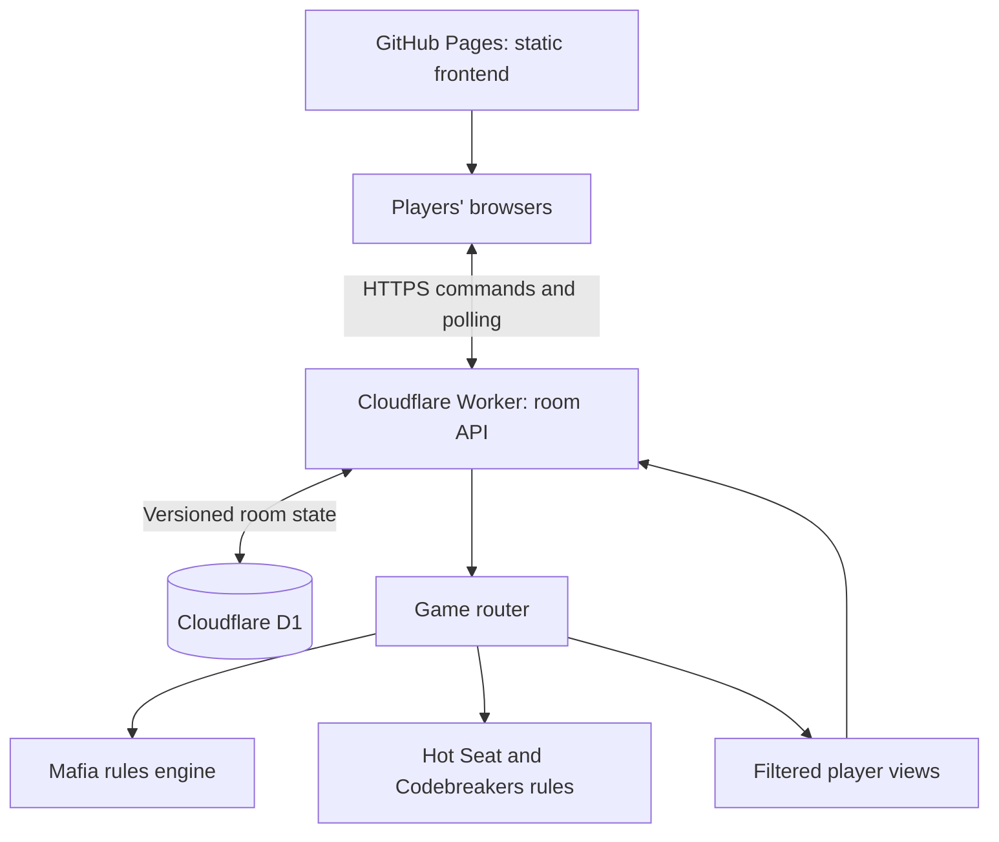

# Alibi Arcade

**Good friends. Great games. Terrible alibis.**

A browser-based multiplayer game hub for friends playing together in person or over a group call. Create a party, share a six-digit code, and play **Mafia**, **Codebreakers**, or **Hot Seat** on separate phones or laptops.

**[Play Alibi Arcade](https://siddharth177.github.io/alibi-arcade/)** · **[Source code](https://github.com/siddharth177/alibi-arcade)**

## Why I built it

My friends and I often played Mafia on weekends, sometimes until the next morning. When everyone went home for Diwali, we missed those sessions. Alibi Arcade started as a way to keep our game nights going over a call, with the app handling the private roles, choices, and votes.

The platform now supports three games through a shared party system, while keeping each game's rules and interface separate.

## The games

| Game | Group size | Host's role | How it plays |
| --- | --- | --- | --- |
| **Mafia** | 5–16 players, plus God | Separate moderator | Find the murderer through night actions, discussion, and private voting. |
| **Codebreakers** | 4–16 people, including the host | Participating player | Two teams connect words using clues while avoiding a hidden trap. |
| **Hot Seat** | 3–16 people, including the host | Participating player | Predict your friends' private answers and earn points for correct guesses. |

### Mafia

God creates the room and moderates the game. Players receive one murderer, one detective, one doctor, and the remaining citizen roles.

- **Night:** the murderer chooses a victim, the doctor protects someone, and the detective investigates a suspect. Citizens also check in privately so their screen activity does not identify their role.
- **Day:** living players discuss the outcome and cast private ballots. God closes the vote and resolves the result.
- **Victory:** Town wins when the murderer is eliminated. Mafia wins when the murderer reaches parity with the remaining living Town players.
- **House rules:** configurable doctor self-protection, consecutive protection, eliminated-role reveals, discussion time, and tied-vote handling.

Eliminated players can watch but cannot act, vote, or use town chat during the game. Detective results are private. God sees the information needed to moderate, and all roles are revealed at the end.

For the single-murderer setup, a group of 5–9 players plus God generally makes for a closer game. The full house rules are available in the app and [the Mafia rulebook](docs/rules.md).

### Codebreakers

Two teams each choose one clue-giver and at least one guesser. The host plays as either role.

- A shuffled **25-word grid** contains nine starting-team words, eight opposing-team words, seven neutral words, and one trap.
- Only clue-givers receive the secret key. Hosting a room does not give a guesser access to it.
- The active clue-giver submits a one-word clue and a positive number. Guessers may make up to that number plus one selections, or end their turn early.
- Finding a neutral or opponent word ends the turn. Finding all of a team's words wins for that team; choosing the trap immediately awards victory to the other team.
- Word selections require confirmation. The key is revealed at the end, and rematches allow the group to choose roles again.

The host can skip a stalled turn if necessary. Clue-givers keep their screens private and remain silent while teammates discuss. The in-app rulebook explains this version's clue restrictions and turn rules.

### Hot Seat

Everyone takes a turn answering a question while the rest of the group predicts their answer.

- Each question has four options. The person in the hot seat privately chooses their answer; everyone else submits a prediction.
- Choices can change until the reveal. Results appear automatically when everyone has submitted.
- Each correct prediction earns **one point**. The hot-seat player does not score in their own round.
- Each person takes the seat once or twice, selected before starting. Forty prompts support a full 16-person, two-turn game without repeating a question.
- The highest score wins, with shared victories for ties. The host can reveal after the seat has answered, excluding missing predictions. The host or hot-seat player can skip a round without awarding points.

## Shared features

- Six-digit party codes, including codes with leading zeros, and shareable invite links.
- Named players, lobby readiness, and host controls.
- Authenticated player sessions without requiring an application account.
- Server-side validation of actions, roles, phases, and win conditions.
- Per-player views that keep unrevealed answers, roles, and board keys private.
- Persistent room state, reconnecting requests, and rematches.
- Public game-event history; Mafia also includes phase-aware town chat and resolved-ballot history.
- Responsive layouts and keyboard-accessible dialogs.

Voice and video are handled through your usual group-call app. Each participant uses their own game screen.

## Architecture

The static frontend and multiplayer backend are deployed separately. GitHub Pages serves the game interface; a Cloudflare Worker processes room requests and stores authoritative game state in Cloudflare D1.



### Request and state flow

1. The frontend creates or joins a room through the HTTPS API. The server issues an opaque session token.
2. Each subsequent authenticated request identifies the player from that token. A client-supplied actor ID cannot override the session identity.
3. The server loads the room, validates the requested action through the appropriate game engine, and calculates the resulting state.
4. The update is written only if the stored room version still matches the version that was read. Concurrent changes trigger bounded retries against the latest state.
5. A filtered view is returned to the requesting player. Browsers poll for updates, send periodic heartbeats, and back off after connection failures.

The server decides outcomes. Browser controls help guide play, while permissions and game rules are enforced again on the backend.

### State and persistence

The database has two main tables:

| Table | Purpose |
| --- | --- |
| `rooms` | Party code, JSON game state, concurrency version, and expiry timestamp. |
| `rate_limits` | Hashed request keys, counters, and rate-limit window expiry. |

Room mutations refresh a **24-hour inactivity expiry**. Expired rooms reject requests and are cleaned up during room creation.

Host sessions are stored in `localStorage`; player sessions are stored in the original tab's `sessionStorage`. These support resuming from the same browser or tab. Clearing browser storage removes the local session credential, even if the room still exists.

### Privacy and validation

- Session credentials are stored as SHA-256 hashes on the server and are omitted from player views.
- Room codes identify parties; they do not authorize actions for an existing player.
- Mafia views filter roles, detective results, night actions, and live ballots according to the viewer's role and game phase.
- Hot Seat views keep the real answer and other players' predictions hidden until results are revealed.
- Codebreakers views omit unrevealed word colours for guessers, including a host who is a guesser.
- The API limits request size and applies rate limits to room creation, joining, and commands.
- Rendered player names and messages are escaped before insertion into the interface.

These controls support the game's privacy rules. Players still need to follow the house rules about private screens, outside messages, and clue-giver conduct.

## Technology stack

| Layer | Technology |
| --- | --- |
| Game interface | HTML5, CSS3, JavaScript ES modules |
| Game logic | Pure JavaScript state transitions and filtered views |
| Browser transport | Fetch API, HTTPS polling, heartbeats, retry backoff |
| Hosted API adapter | TypeScript and Vinext using Next.js-style route handlers |
| Backend runtime | Cloudflare Workers |
| Database | Cloudflare D1 / SQLite, with SQL migrations |
| Randomisation and token hashing | Web Crypto API |
| Build tooling | Vite, Vinext, pnpm |
| Automated tests | Node.js test runner, assertions, and built-in SQLite |
| Frontend deployment | GitHub Pages and GitHub Actions |

The game screens use plain browser modules. The framework layer provides the hosted entry point and API adapter; it is separate from the game UI and rules.

## Repository structure

| Path | Responsibility |
| --- | --- |
| `web/index.html`, `web/styles.css` | Static application shell and styles. |
| `web/js/app.js` | Main interface, routing between screens, forms, and player interactions. |
| `web/js/games.js` | Game catalogue and metadata. |
| `web/js/network.js` | Room transport, session storage, polling, and reconnect behaviour. |
| `web/js/game-router.js` | Dispatches state creation, commands, and views to the correct engine. |
| `web/js/engine.js` | Mafia rules, roles, night actions, voting, and win checks. |
| `web/js/party-games.js` | Hot Seat and Codebreakers rules, scoring, and private views. |
| `web/js/party-ui.js` | Hot Seat and Codebreakers screens and rulebooks. |
| `server/api.mjs` | HTTP endpoints, authentication, persistence, concurrency, and request limits. |
| `app/api/[...path]/route.ts` | Connects the HTTP handler to the hosted database binding. |
| `worker/index.ts` | Worker runtime entry point. |
| `drizzle/` | Database migrations. |
| `tests/` | Rules-engine and HTTP-handler integration tests. |
| `scripts/` | Asset preparation, checks, development helpers, and publishing scripts. |
| `.github/workflows/` | Verification and GitHub Pages deployment. |
| `public/` | Copy of `web/` used by the full-stack build. |

**Edit `web/` for frontend changes.** `npm run prepare:web` copies it to `public/`. The GitHub Pages workflow publishes `web/` directly; the Worker build uses the prepared assets and emits `dist/`.

## Run the checks

Use **Node.js 22.13 or newer**. The game tests and static checks do not require installing the framework dependencies.

```bash
npm test
npm run build:pages
```

The current suite contains **46 automated tests** covering:

- Mafia roles, doctor saves, detective privacy, night actions, voting, spectators, and victory conditions.
- Hot Seat answer privacy, scoring, seat rotation, skipped rounds, ties, and rematches.
- Codebreakers team setup, secret-key filtering, clue validation, turn permissions, extra guesses, trap outcomes, and victories.
- Authenticated HTTP game cycles, simultaneous room joins and private choices, session restoration, expiry, and invalid requests.
- Snapshots that cannot mutate the authoritative state.

HTTP-handler tests use an in-memory SQLite adapter for the D1-style database interface. `build:pages` validates JavaScript syntax and referenced static assets; it does not build or deploy the backend.

## Full-stack development

Use the pnpm version declared in `package.json`—currently **11.25.0**—to install the locked framework dependencies:

```bash
pnpm install --frozen-lockfile
npm run build
```

Initialise the local database after the build has created its Worker configuration:

```bash
node --import ./scripts/sites-env.mjs \
  ./node_modules/wrangler/bin/wrangler.js d1 execute DB \
  --local \
  --config dist/server/wrangler.json \
  --persist-to .wrangler/state \
  --file drizzle/0000_reflective_ben_grimm.sql
```

Apply the initial migration once per fresh local database. Then start development:

```bash
npm run dev
```

The portable development command uses port `5173`; managed preview environments provide their own URL. The local API needs a configured `DB` binding and the room tables above. Binding declarations are in `.openai/hosting.json`, with local Worker configuration supplied by `vite.config.ts`.

## Room API

| Method | Endpoint | Purpose |
| --- | --- | --- |
| `GET` | `/api/health` | Report service availability and supported games. |
| `POST` | `/api/party` | Create a room for `mafia`, `codebreakers`, or `hotseat`. |
| `POST` | `/api/party/:code/join` | Join a room that is still in its lobby. |
| `GET` | `/api/party/:code` | Read the authenticated player's current view. |
| `POST` | `/api/party/:code/command` | Submit an authenticated game action or heartbeat. |

For example, the room-creation request body can be:

```json
{
  "name": "Siddharth",
  "game": "hotseat"
}
```

Creation and joining return a session and the caller's view. Later room requests send `Authorization: Bearer <session-token>`. Responses never include another player's credential.

## Deployment

### GitHub Pages frontend

The existing [live site](https://siddharth177.github.io/alibi-arcade/) uses the shared room service at:

```text
https://alibi-arcade.siddharthreads17.chatgpt.site
```

The Pages workflow runs after a push to `main`, and also supports manual dispatch. It:

1. Runs the tests and static asset checks.
2. Confirms that the shared room service is publicly reachable and supports all three games.
3. Uploads `web/` and deploys it to GitHub Pages.

The repository owner's publishing helper can commit and push the source, configure Pages, and request deployment:

```bash
bash scripts/publish-github.sh
```

The helper checks that the active GitHub CLI account is `siddharth177` and reuses a matching existing remote. It preserves the visibility of an existing repository. If local and remote branches have diverged, reconcile them before running the helper.

To request deployment manually after the source has been pushed:

```bash
gh workflow run publish-pages.yml \
  --repo siddharth177/alibi-arcade \
  --ref main
```

### Multiplayer backend

GitHub Pages hosts the static interface. The room API requires a separate Worker deployment with a D1 database bound as `DB` and the migrations applied. Publishing the frontend does not update that backend.

The full-stack build emits the Worker configuration and output under `dist/server/`. The current hosted service is deployed separately from the GitHub Pages workflow.

For another backend deployment, set `globalThis.ALIBI_API_ORIGIN` before the app module loads, or update the origin in `web/js/network.js`. The room API supports cross-origin HTTPS requests so the frontend and backend can use different hosts.

## Adding a game

The shared room service handles sessions, persistence, and transport. To extend the catalogue:

1. Implement the game's state creation, player joining, command validation, and filtered views.
2. Register it with the game router and supported-game validation, then add its catalogue entry.
3. Add its interface and in-app rules.
4. Cover privacy, permissions, complete game flow, and rematches in the tests.
5. Update the service capabilities and deployment checks before publishing the frontend.

## Rules and references

Mafia has several house-rule variants. This project's choices are documented in its rulebook, informed by:

- [Andrew Plotkin's Werewolf rules](https://www.eblong.com/zarf/werewolf.html)
- [Mafia Round rules](https://mafiaround.com/rules)
- [Partyy Games rules](https://mafia.partyygames.com/rules)

Hot Seat and Codebreakers use the specific versions described above and in their in-app rulebooks.
